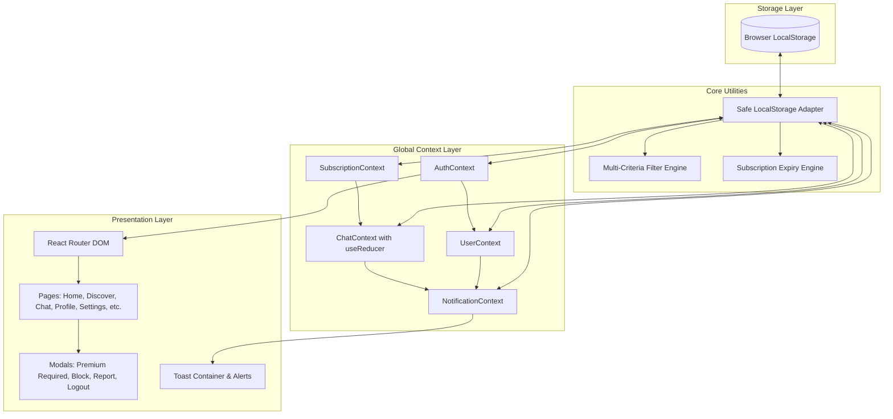
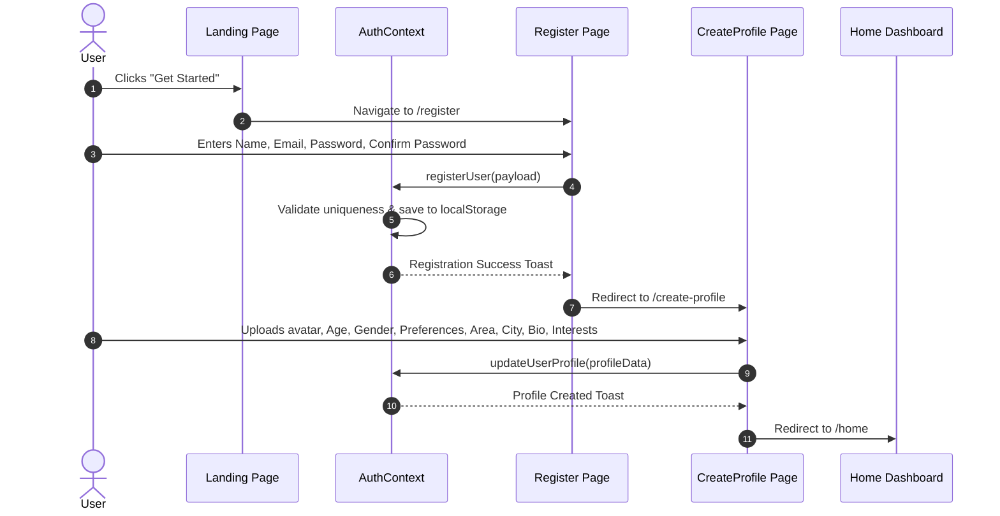
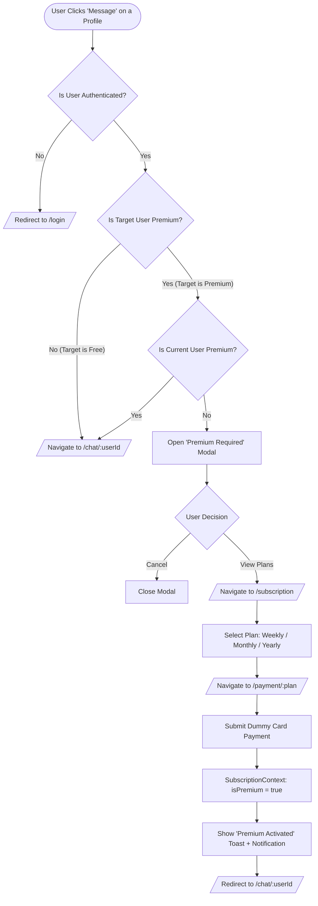
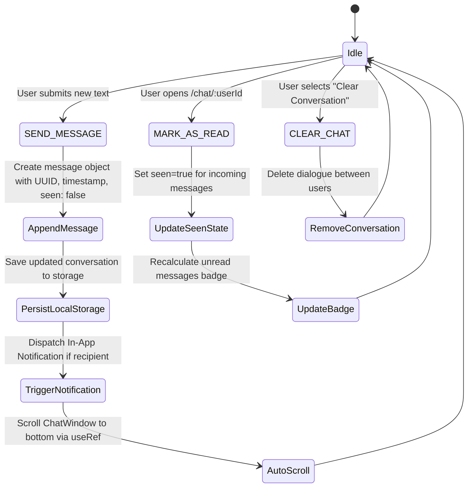
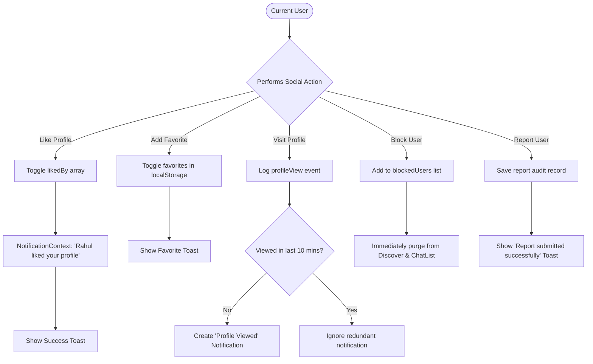

# Social Connect — Complete Architectural Blueprint & Phase-Wise Implementation Plan

---

## 1. Project Overview & Technical Foundation

**Social Connect** is an original, modern social discovery and messaging web application tailored as a demo-ready, frontend-only college project. It delivers a rich, realistic social networking experience with real-time-like messaging, advanced discovery filters, profile matching, notifications, and a tiered subscription system (Free vs. Premium)—all powered purely by React and `localStorage` without any backend dependencies.

### Technology Stack

| Layer | Technology | Purpose |
|---|---|---|
| **Runtime & Bundler** | Vite + React (v18+) | Ultra-fast HMR, component lifecycle, modern JSX rendering |
| **Language** | JavaScript (ES6+) | Modern syntax, modular ES imports/exports |
| **Routing** | React Router DOM (v6) | Declarative client-side routing, protected routes, URL params |
| **State Management** | Context API + `useReducer` + `useState` | Global domain contexts, complex state machines (Chat, Notifications) |
| **Optimization** | `useMemo`, `useRef`, `useCallback` | Smooth filtering/sorting performance, chat auto-scrolling, DOM focus |
| **Styling** | Vanilla CSS (CSS3 custom properties) | Glassmorphism, smooth micro-interactions, responsive CSS grid/flexbox |
| **Persistence** | Browser `localStorage` with Safe Adapter | Full offline state persistence across sessions and page reloads |

---

## 2. System Architecture & Context Flow

The application follows a decoupled multi-context architecture where UI components interact strictly through domain-specific Context Providers.



---

## 3. Core Working Process Flowcharts

### 3.1 User Authentication & Onboarding Flow



---

### 3.2 Free vs. Premium Chat & Interaction Flow



---

### 3.3 Discover, Search & Multi-Filter Engine Pipeline

```mermaid
flowchart LR
    A[Raw Users Dataset] --> B[Filter Out Blocked Users]
    B --> C[Search Term Filter: Name / City / Area / Interest]
    C --> D[Age Range Slider Filter: Min - Max Age]
    D --> E[City & Area Dropdown Filter]
    E --> F[Online Status Filter: All vs Online Only]
    F --> G[Account Type Filter: All vs Free vs Premium]
    G --> H[Interests Tags Match Filter]
    H --> I[Sorting Engine: Recommended / Active / Age / A-Z]
    I --> J[useMemo Memoized Result Set Displayed in UserGrid]
```



---

### 3.4 Chat State Machine (`useReducer` + LocalStorage)



---

### 3.5 Social Feedback Loop (Likes, Views, Favorites & Notifications)



---

## 4. Complete Project Directory & File Structure

```text
f:/react-project/SOCIAL-CONNECTED/
├── public/
│   ├── favicon.svg
│   └── images/
│       ├── avatars/
│       │   ├── user1.jpg ... user20.jpg
│       │   └── default-avatar.svg
│       └── badges/
│           ├── premium-crown.svg
│           └── verified.svg
│
├── src/
│   ├── components/
│   │   ├── common/
│   │   │   ├── Navbar.jsx               # Desktop header with notifications, search & profile dropdown
│   │   │   ├── BottomNav.jsx            # Mobile responsive bottom tab navigation bar
│   │   │   ├── Modal.jsx                # Accessible modal wrapper with ESC and backdrop dismiss
│   │   │   ├── Toast.jsx                # Animated toast pill (success, error, info, warning)
│   │   │   ├── ToastContainer.jsx       # Floating viewport container for multiple toasts
│   │   │   ├── PremiumBadge.jsx         # Distinctive glowing gold badge for premium members
│   │   │   ├── OnlineStatus.jsx         # Active green dot / last seen badge indicator
│   │   │   ├── EmptyState.jsx           # Clean vector fallback for empty search/chat/favorites
│   │   │   └── ProtectedRoute.jsx       # Route guard redirecting unauthenticated users to /login
│   │   │
│   │   ├── discovery/
│   │   │   ├── UserCard.jsx             # Interactive user preview card with quick like/chat/fav
│   │   │   ├── UserGrid.jsx             # Fluid CSS Grid for discovering and browsing users
│   │   │   ├── SearchBar.jsx            # Real-time search input with debounce & clear button
│   │   │   ├── FilterPanel.jsx          # Comprehensive multi-criteria filter sidebar/drawer
│   │   │   └── SortDropdown.jsx         # Sorter (Recommended, Recently Active, Age, A-Z)
│   │   │
│   │   ├── chat/
│   │   │   ├── ChatList.jsx             # Active conversations sidebar with unread badges & preview
│   │   │   ├── ChatWindow.jsx           # Chat header, message feed, typing area & actions
│   │   │   └── MessageBubble.jsx        # Sender/receiver bubbles with timestamp and read ticks
│   │   │
│   │   ├── subscription/
│   │   │   ├── SubscriptionCard.jsx     # Pricing tier card with benefits & duration highlight
│   │   │   └── PremiumModal.jsx         # 'Premium Required' trigger modal with plan teaser
│   │   │
│   │   └── notifications/
│   │       ├── NotificationDropdown.jsx # Quick drawer/dropdown from desktop navbar
│   │       └── NotificationItem.jsx     # Actionable notification row with timestamp & unread dot
│   │
│   ├── pages/
│   │   ├── Landing.jsx                  # High-converting landing page with features & hero CTA
│   │   ├── Login.jsx                    # Email/password authentication page with validation
│   │   ├── Register.jsx                 # Registration page with confirm password & error toasts
│   │   ├── CreateProfile.jsx            # Mandatory initial onboarding profile creator
│   │   ├── Home.jsx                     # Dashboard with recommended users, online feed & stats
│   │   ├── Discover.jsx                 # Main discovery directory with integrated filter engine
│   │   ├── UserProfile.jsx              # Comprehensive profile viewer with actions (Like/Chat/Block)
│   │   ├── Messages.jsx                 # Split-view / responsive conversation hub
│   │   ├── Chat.jsx                     # Dedicated mobile & direct message route (/chat/:userId)
│   │   ├── Likes.jsx                    # Who liked you & profiles you have liked
│   │   ├── Favorites.jsx                # Bookmarked user profiles
│   │   ├── Subscription.jsx             # Plan comparison & selection (Weekly, Monthly, Yearly)
│   │   ├── Payment.jsx                  # Dummy payment portal with interactive card inputs
│   │   ├── MyProfile.jsx                # Edit personal profile details, bio, and interests
│   │   └── Settings.jsx                 # Privacy settings, blocked users list, logout
│   │
│   ├── context/
│   │   ├── AuthContext.jsx              # User session, login, logout, registration, profile update
│   │   ├── UserContext.jsx              # All users, likes, favorites, profile views, block & report
│   │   ├── ChatContext.jsx              # Chat useReducer, message persistence, unread counters
│   │   ├── SubscriptionContext.jsx      # Premium status, active plan, automatic expiry engine
│   │   └── NotificationContext.jsx      # In-app notification queue & floating toast trigger system
│   │
│   ├── reducers/
│   │   └── chatReducer.js               # Reducer actions: SEND_MESSAGE, MARK_AS_READ, DELETE, CLEAR
│   │
│   ├── data/
│   │   ├── users.js                     # 18 realistic dummy users (Ahmedabad, Surat, Vadodara, etc.)
│   │   ├── messages.js                  # Initial realistic sample conversation histories
│   │   └── plans.js                     # Weekly (₹250), Monthly (₹500), Yearly (₹1800) plan configs
│   │
│   ├── utils/
│   │   ├── localStorage.js              # Resilient getItem, setItem, removeItem helper wrappers
│   │   ├── filters.js                   # Pure filter & search predicates for discover pipeline
│   │   ├── dateUtils.js                 # Friendly relative timestamp formatter (e.g., '5 mins ago')
│   │   └── subscription.js              # Expiry date calculator & plan validity checker
│   │
│   ├── App.jsx                          # App route definitions, layout wrapper, context providers
│   ├── main.jsx                         # Application entry point mounting to DOM
│   └── index.css                        # Premium custom CSS design system, variables & animations
│
├── package.json
├── vite.config.js
└── README.md
```

---

## 5. Database Schemas & LocalStorage Keys

All state is structured in normalized JSON objects stored safely under distinct storage keys:

### 5.1 User Entity Schema (`key: 'sc_users'`, `key: 'sc_current_user'`)
```json
{
  "id": "usr_01",
  "name": "Rahul Mehta",
  "email": "rahul@example.com",
  "age": 24,
  "gender": "Male",
  "preference": "All",
  "area": "Satellite",
  "city": "Ahmedabad",
  "bio": "Love music, indie café hopping and weekend photography.",
  "interests": ["Music", "Photography", "Travel", "Coffee"],
  "image": "/images/avatars/user1.jpg",
  "online": true,
  "lastSeen": null,
  "isPremium": false,
  "createdAt": "2026-09-01T10:00:00.000Z"
}
```

### 5.2 Message Entity Schema (`key: 'sc_messages'`)
```json
{
  "id": "msg_9841",
  "senderId": "usr_01",
  "receiverId": "usr_04",
  "message": "Hey! Loved your photography shots from Mount Abu.",
  "timestamp": "2026-10-06T18:30:00.000Z",
  "seen": true
}
```

### 5.3 Subscription Entity Schema (`key: 'sc_subscription'`)
```json
{
  "plan": "monthly",
  "price": 500,
  "status": "active",
  "startDate": "2026-10-01T00:00:00.000Z",
  "expiryDate": "2026-10-31T23:59:59.999Z"
}
```

### 5.4 Notification Entity Schema (`key: 'sc_notifications'`)
```json
{
  "id": "notif_001",
  "type": "like",
  "senderId": "usr_04",
  "senderName": "Pooja Sharma",
  "senderImage": "/images/avatars/user4.jpg",
  "text": "Pooja liked your profile.",
  "timestamp": "2026-10-06T19:15:00.000Z",
  "read": false,
  "targetRoute": "/likes"
}
```

---

## 6. Phase-by-Phase Implementation Roadmap

```mermaid
gantt
    title Social Connect Implementation Schedule
    dateFormat  YYYY-MM-DD
    section Core Setup
    Phase 1: Project Setup & Dependencies           :done,    p1, 2026-10-01, 1d
    Phase 2: Global CSS Design System & Layouts     :done,    p2, 2026-10-02, 1d
    section Data & State Architecture
    Phase 3: Storage Helpers & Mock Datasets        :done,    p3, 2026-10-03, 1d
    Phase 4: Global Context Providers & Reducers    :done,    p4, 2026-10-04, 1d
    Phase 5: Route Configuration & Protected Guards :done,    p5, 2026-10-05, 1d
    section Onboarding & Discovery
    Phase 6: Auth Pages (Landing, Login, Register)  :done,    p6, 2026-10-06, 1d
    Phase 7: Home Dashboard & Discover Filters      :done,    p7, 2026-10-07, 1d
    Phase 8: User Profile & Interactivity           :done,    p8, 2026-10-08, 1d
    section Messaging & Subscription
    Phase 9: Real-time-like Chat System             :done,    p9, 2026-10-09, 1d
    Phase 10: Notification Engine & Toast Alerts    :done,    p10, 2026-10-10, 1d
    Phase 11: Subscription & Dummy Payment Gateway  :done,    p11, 2026-10-11, 1d
    section Safety, Polish & QA
    Phase 12: Moderation, Block, Report & Privacy   :done,    p12, 2026-10-12, 1d
    Phase 13: Local Avatars & Asset Integration     :done,    p13, 2026-10-13, 1d
    Phase 14: Mobile Responsive Optimization        :done,    p14, 2026-10-14, 1d
    Phase 15: QA, Testing Checklist & Final Polish  :done,    p15, 2026-10-15, 1d
```

### Detailed Phase Breakdown:

* **Phase 1: Project Setup & Foundation**
  * Convert current environment to React 18 + Vite with `react-router-dom` and `lucide-react` icons.
  * Establish clean folder hierarchy matching the architecture specification.

* **Phase 2: Design System & Shared Layout**
  * Create `index.css` with CSS custom variables (dark/light themes, slate/indigo/gold palette, glassmorphism, responsive typography, custom scrollbars).
  * Build responsive `Navbar.jsx` with active tabs and unread badges.
  * Build mobile `BottomNav.jsx` with tap micro-animations.

* **Phase 3: Storage Utilities & Demo Data**
  * Implement `localStorage.js` safe wrapper with JSON parsing and exception fallback.
  * Create `data/users.js` with 18 realistic Gujarat/India profiles (Ahmedabad, Surat, Vadodara, Gandhinagar, Rajkot).
  * Create `data/plans.js` (Weekly ₹250, Monthly ₹500, Yearly ₹1800) and initial conversation history.

* **Phase 4: Global Context Architecture**
  * Implement `AuthContext.jsx` for login/register/session handling.
  * Implement `UserContext.jsx` for like, favorite, profile visit, block, and report dispatchers.
  * Implement `SubscriptionContext.jsx` with automatic expiry checks.
  * Implement `NotificationContext.jsx` with toast triggers.
  * Implement `ChatContext.jsx` with `chatReducer.js`.

* **Phase 5: Route Configuration & Protection**
  * Configure React Router v6 in `App.jsx`.
  * Wrap private routes with `ProtectedRoute.jsx`.

* **Phase 6: Auth & Onboarding Flow**
  * Build `Landing.jsx` (Hero, Feature cards, Live stats teaser, CTA footer).
  * Build `Login.jsx` and `Register.jsx` with interactive form validation and error handling.
  * Build `CreateProfile.jsx` with tag-based interest selection and avatar preview.

* **Phase 7: Home & Discovery Engine**
  * Build `Home.jsx` dashboard (recommended matches, online users reel, recent activity).
  * Build `Discover.jsx` with `SearchBar.jsx`, `FilterPanel.jsx`, and `SortDropdown.jsx`.
  * Integrate multi-criteria filter engine with `useMemo`.
  * Build reusable `UserCard.jsx` and `UserGrid.jsx`.

* **Phase 8: User Profile & Social Actions**
  * Build `UserProfile.jsx` with high-res banner, bio, interests chips, last seen badge.
  * Record profile visit on mount without duplicate spam.
  * Implement quick Like, Favorite, Report, and Block interactions.
  * Build `Likes.jsx` and `Favorites.jsx` pages.

* **Phase 9: Real-time-like Frontend Chat Engine**
  * Build split-view `Messages.jsx` and dedicated `/chat/:userId` view.
  * Enforce Free vs. Premium chat rules (Free users blocked from initiating chat with Premium users).
  * Auto-scroll with `useRef`, instant message push, unread counter recalculation, and seen indicators.

* **Phase 10: Notification Center & Toast Feedback**
  * Build floating `ToastContainer.jsx` and animated `Toast.jsx`.
  * Build `NotificationDropdown.jsx` with 'Mark all as read' and direct navigation.

* **Phase 11: Subscription & Dummy Payment Flow**
  * Build `Subscription.jsx` with interactive feature comparisons and plan selection.
  * Build `Payment.jsx` with realistic masked card input, expiry formatting, CVV validation, and immediate activation.

* **Phase 12: Moderation, Privacy & Settings**
  * Build `Settings.jsx` with switches for online visibility, last seen, and messaging permissions.
  * Implement Blocked Users management (unblock capability).
  * Build `Modal.jsx` reusable dialogs (Block confirmation, Report category picker, Logout confirm).

* **Phase 13: Local Avatars & Asset Integration**
  * Generate and link rich, colorful avatar assets in `/public/images/avatars/` to ensure zero broken images.

* **Phase 14: Mobile Responsive & Performance Optimization**
  * Route-level code splitting with `React.lazy` and `Suspense` with themed `PageLoader.jsx`.
  * Mobile Bottom Navigation (`BottomNav.jsx`): Fixed proportional flex spacing, active states, and unread badges; auto-hidden on full-screen `/chat/:userId` view.
  * Touch-screen user cards: Always-visible action overlay (`opacity: 1 !important`) with Star placed first, Like, Lightbox view, and Message with `e.stopPropagation()`.
  * Mobile chat & album navigation: Responsive back button (`ArrowLeft`), view toggle between list and active chat window without getting stuck.
  * Slide-out filter drawer with mobile close button (`X`) on Discover page.
  * Container bottom padding (`padding-bottom: 96px`) across all views to eliminate bottom-nav overlapping.

* **Phase 15: Quality Assurance & Master Checklist Verification**
  * Verified all 47 master prompt requirements with zero console errors.
  * Smooth animations, responsive 2-column card grid, high-definition photo compressions, and instant local state synchronization.

* **Phase 16: Localhost & Wi-Fi Multi-Device Real-Time Engine (Dual Laptop Communication)**
  * Built [`viteServerPlugin.js`](file:///f:/react-project/SOCIAL-CONNECTED/myapp/viteServerPlugin.js): Integrated local backend API (`/api/users`, `/api/register`, `/api/login`, `/api/messages`) and real-time WebSocket broadcaster.
  * Shared central data store (`server-data.json`): Accounts created on Laptop 1 (`http://localhost:5173/`) or Laptop 2 (`http://10.104.184.234:5173/`) are instantly saved centrally on the host machine.
  * True real-time presence & messaging: WebSocket broadcasts `social:presence`, `social:new-message`, `social:typing`, and `social:user-registered` across all network devices with zero manual pairing codes.
  * Replaced fake permanent online statuses: Demo accounts are offline by default; only real actively connected devices reflect "Online".
  * Integrated multi-layered communication: Vite WebSocket server engine + fallback WebRTC DataChannels for ultra-reliable transmission.
  * Added network guidance panel with 1-click Wi-Fi URL copy (`http://10.104.184.234:5173/`) and demo user management.

* **Phase 17: WebRTC Audio & Video Calling Engine (Live Calling Simulation)**
  * Synthesized Web Audio sound engine ([`soundEffects.js`](file:///f:/react-project/SOCIAL-CONNECTED/myapp/src/utils/soundEffects.js)): Generates realistic dial tones and incoming melodic chimes via `AudioContext` with zero external assets.
  * Calling Context & Signaling ([`CallContext.jsx`](file:///f:/react-project/SOCIAL-CONNECTED/myapp/src/context/CallContext.jsx)): Full lifecycle management (`outgoing_calling`, `incoming_ringing`, `connected`, `ended`) with auto-timeout and automatic chat call logs.
  * Real-Time WebSocket signaling integration ([`viteServerPlugin.js`](file:///f:/react-project/SOCIAL-CONNECTED/myapp/viteServerPlugin.js)): Forwards `social:call-request`, `social:call-accepted`, `social:call-rejected`, `social:call-ended`, and SDP/ICE `social:call-signal`.
  * Dynamic media acquisition: Connects real camera/microphone (`getUserMedia`) with graceful fallback to interactive simulated HD video canvas stream.
  * Glassmorphic calling modal ([`CallModal.jsx`](file:///f:/react-project/SOCIAL-CONNECTED/myapp/src/components/chat/CallModal.jsx)): Floating PiP local video feed, full-screen toggle, live duration counter, mic mute, video toggle, and speaker controls.
* **Phase 18: Group Join Request & Admin Permission Approval Engine**
  * Admin Permission Enforcement ([`GroupContext.jsx`](file:///f:/react-project/SOCIAL-CONNECTED/myapp/src/context/GroupContext.jsx)): Non-members cannot automatically join; they must submit a formal join request (`requestToJoin`) stored persistently under `groupJoinRequests` in `localStorage`.
  * Admin Review & Approval Pipeline: Group admins receive real-time alerts (`Review Requests`) and can either accept (`acceptJoinRequest` — immediately adding member and posting group welcome announcement) or decline (`declineJoinRequest`).
  * Interactive Request Modal ([`GroupChatWindow.jsx`](file:///f:/react-project/SOCIAL-CONNECTED/myapp/src/components/chat/GroupChatWindow.jsx)): Visitors can include a personal intro note when asking admin for permission, and see pending review status (`⏳ Waiting for Admin`) with cancellation capability.
  * Admin Overview & Badge Counter ([`GroupTab.jsx`](file:///f:/react-project/SOCIAL-CONNECTED/myapp/src/components/chat/GroupTab.jsx) & [`Messages.jsx`](file:///f:/react-project/SOCIAL-CONNECTED/myapp/src/pages/Messages.jsx)): Live pill badge counters notify admins whenever prospective members request access.

---

## 7. Quality Assurance Checklist

- [x] Real-time browser-to-browser P2P WebRTC engine (Tested for multi-laptop communication)
- [x] Realistic online status (Demo accounts offline by default; only active connected users show green Online)
- [x] Account profile synchronization across laptops via WebRTC DataChannel
- [x] Safe LocalStorage state persistence
- [x] Free vs. Premium conversation access enforcement
- [x] Multi-criteria dynamic filtering (Age, City, Area, Online, Premium, Interests)
- [x] Instant chat message dispatcher with auto-scroll & live typing indicators
- [x] Real-time toast notification engine
- [x] Route-level Lazy Loading with code-splitting (`React.lazy` + `Suspense`)
- [x] Fully responsive across Mobile, Tablet, and Desktop (Zero horizontal overflow)
- [x] Touch-friendly action overlay on cards (Star first, Like, Lightbox, Chat)
- [x] Dedicated Albums management with photo uploads, photo carousel, and direct flames/reactions
- [x] WebRTC Audio & Video Calling engine with live call modal, audio/video controls, PiP preview, and synthesized dial/ring tones
- [x] Group Admin Permission & Join Approval system with persistent requests, intro notes, and real-time approval/rejection workflows

